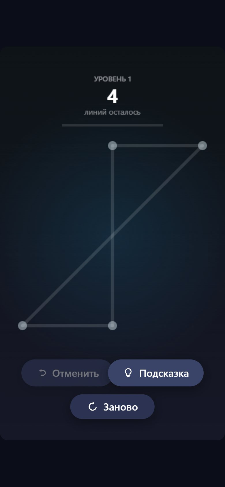
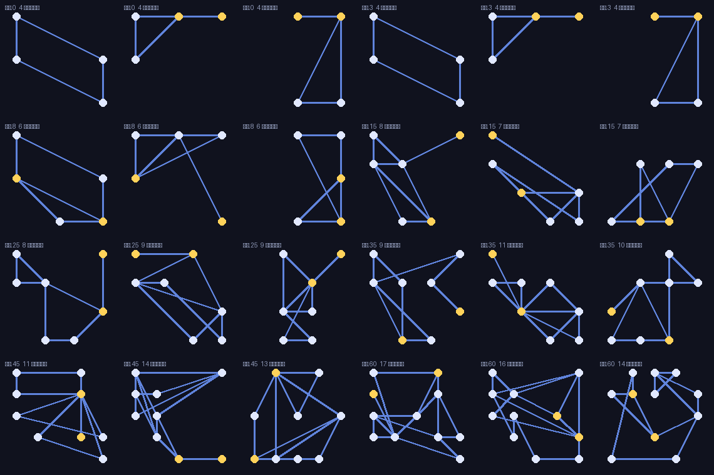

<div align="center">

# Один росчерк

**Головоломка: обведи фигуру одной линией. Уровни строятся генератором эйлеровых путей.**

 

</div>

<table>
<tr>
<td align="center" valign="top"></td>
<td align="center" valign="top"></td>
</tr>
</table>

<!-- header:end -->
Головоломка для браузера и мобильных: обведи фигуру одной линией, не отрывая пальца и не проходя по ребру дважды.

## Как это устроено

Каждый уровень — граф, у которого должен существовать **эйлеров путь**: граф связен, а вершин нечётной степени ровно 0 или 2. Генератор (`src/levelgen.js`) строит граф так, чтобы условие выполнялось по построению, а потом всё равно проверяет результат: брак дешевле выбросить, чем показать игроку нерешаемый уровень.

Ещё пара деталей, без которых играть неудобно:

- ребро не может проходить через третью вершину, иначе игрок не отличит одно длинное ребро от двух коротких;
- уровни детерминированы: собственный сидируемый ГПСЧ (`src/rng.js`), поэтому уровень N у всех одинаковый;
- есть отмена хода и подсказка следующего ребра (`hintFor` в `src/board.js`).

## Структура

```
index.html        — разметка, стили, кнопки
src/main.js       — игровой цикл и ввод (мышь/тач)
src/levelgen.js   — генерация уровней
src/board.js      — состояние доски, проверка хода, подсказки
src/render.js     — отрисовка на canvas, темы
tools/            — тесты генератора и доски, выгрузка превью уровней
```

## Запуск

Чистый JS без сборки, но ES-модули работают только через http:

```bash
python -m http.server 8000
# http://localhost:8000
node tools/test-levelgen.mjs   # проверка генератора
```
